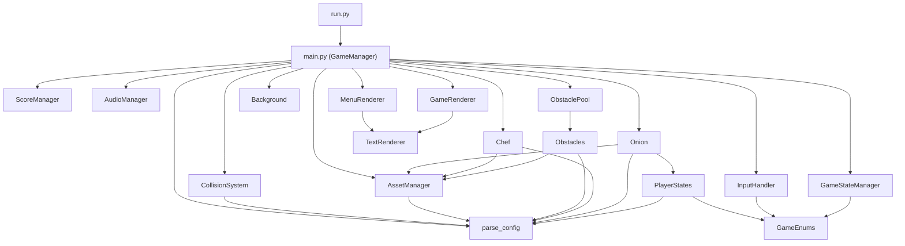

# Onion-Run: Codebase Wiki

> Map of the sources in `src/` (19 Python files, about 2,100 lines). It helps you see at a
> glance which file you are looking at, what each one does and who depends on whom.
> Last updated: 25 Oct 2026.

Onion-Run is a 2D endless runner in **Python + pygame**, in the style of Subway Surfers.
An onion runs away from a chef along three lanes and dodges kitchen obstacles (a pan, a
cabbage, a knife block). The longer you survive, the faster the game gets.
It is Renato's **first Python project**, built to learn the language.

---

## 1. How to run

```
python run.py
```

`run.py` moves the process into the project folder (so `config.xml`, `assets/` and
`high_score.txt` are found from any launch directory), adds `src/` to the module path and
calls `main()` from `src/main.py`. Requires `pip install pygame`.

Running `src/main.py` directly from another folder fails with `Error parsing config.xml`,
because the configuration file is opened with a relative path.

### Controls
| Key | Action |
|---|---|
| Enter | From the menu go to skin selection, then start the game |
| A / Left arrow, D / Right arrow | Change lane (or browse skins in the menu) |
| W / Up arrow | Jump |
| S / Down arrow | Crouch |
| Space | Pause and resume (with a countdown) |
| R | Restart after game over |
| Esc | In the menu or skin selection: quit. While playing: pause, and from pause back to the menu. From game over: back to the menu |

---

## 2. Layered architecture

The code uses **composition**: one `GameManager` class (in `main.py`) owns one object for
each responsibility and coordinates them in the game loop.

| Layer | What it does | Files |
|---|---|---|
| **Configuration** | Reads `config.xml` and exposes constants (lanes, speed, difficulty, paths) | `parse_config.py` |
| **Resources** | Loads and caches images and fonts, scales sprites | `AssetManager.py` |
| **Game state** | Menu, skin selection, playing, game over, pause | `GameStateManager.py`, `GameEnums.py` |
| **Entities** | Player, chef, obstacles | `Onion.py`, `PlayerStates.py`, `Chef.py`, `Obstacles.py`, `ObstaclePool.py` |
| **Rules** | Collisions, score | `CollisionSystem.py`, `ScoreManager.py` |
| **Input** | Translates keys into actions | `InputHandler.py` |
| **Rendering** | Menus, gameplay, text, background | `MenuRenderer.py`, `GameRenderer.py`, `TextRenderer.py`, `Background.py` |
| **Audio** | Menu, gameplay and game over music | `AudioManager.py` |
| **Coordinator** | Main loop, spawning, difficulty | `main.py` |

---

## 3. Dependency graph

Arrows go from the user to the thing used.



`parse_config` is the foundation: almost every module imports its constants.

---

## 4. File by file

### `run.py`
Entry point. Changes the working directory, adds `src/` to `sys.path`, imports `main`.

### `src/main.py` (504 lines)
Contains `GameManager`, the coordinator.
- `__init__`: initialises pygame, creates all managers, the sprite groups and the obstacle
  pool, and loads the skin previews.
- `run()`: main loop (events, update, draw, `clock.tick`).
- `update_gameplay()`: advances the background, difficulty, spawning, chef, player,
  obstacles and score; checks collisions and moves to game over.
- `_update_difficulty()`: at every interval increases `difficulty_multiplier` up to a maximum
  and updates the speed of obstacles already on screen.
- `spawn_obstacle()` with `_find_available_lane` and `_is_lane_available`: pick a free lane
  at random, with a maximum number of attempts.
- `update_player_layering()` / `_update_sprite_sorting()`: sort sprites by `z_index` so the
  player passes in front of or behind obstacles.
- `update_available_skins()`: unlocks skins based on the record score.
- `process_input_result()`: executes the actions produced by `InputHandler`.

### `src/parse_config.py` (214 lines)
Reads `config.xml` with `xml.etree` and produces module constants: `LANES`, `SPEED`, `FPS`,
`GROUND_Y`, `JUMP_VELOCITY`, `GRAVITY`, `OBSTACLE_INTERVAL`, `MAX_DIFFICULTY`, the `ASSETS`
dictionary with all paths, and so on. If the file is missing it prints an error and the game
does not start.

### `src/AssetManager.py`
Loads images (`load_image`) and fonts (`load_font`) with a cache, returns the player's images
per skin and state (`get_player_images`) and the obstacle image per type (`get_obstacle_image`).

### `src/GameEnums.py`
Two enums: `GameState` (MENU, SKIN_SELECTION, PLAYING, GAME_OVER) and `InputAction` (QUIT,
PAUSE, MOVE_LEFT, JUMP, CROUCH, and so on).

### `src/GameStateManager.py`
Keeps the current state and the pause: `pause_game`, `resume_game`, `update_pause` (handles the
resume countdown), `start_new_game`, `go_to_menu`, `game_over`.

### `src/InputHandler.py`
Executes nothing: converts `(key, game state)` into an `{"action": ...}` dictionary. One
method per state: menu, skin selection, gameplay, game over. It keeps keys separate from logic.

### `src/Onion.py` (the player)
A pygame sprite with three running images, one jumping and one crouching. It stores the current
lane (0, 1, 2), the vertical velocity for jumps and a collision rectangle smaller than the
sprite. It delegates behaviour to a state object.

### `src/PlayerStates.py` (State pattern)
Abstract class `PlayerState` with `enter`, `update`, `handle_input`, `get_state_name`, and three
implementations:
- `RunningState`: running animation, accepts jump and crouch.
- `JumpingState`: physics with velocity and gravity, lands back in `RunningState`.
- `CrouchingState`: lasts a fixed time, then returns to running.
Each state also changes the size of the collision rectangle and the `z_index`.

### `src/Chef.py`
The chef chases the player: follows the player's lane with smooth movement, slowly moves down
the screen and cycles through three images (left, back, right) for the animation.

### `src/Obstacles.py`
Obstacle sprite with three randomly chosen types: `pan`, `cabbage`, `knife_block`. Each has its
own `z_index`. The knife block has a reduced collision rectangle (half height, 80% width).
`reset()` puts the obstacle back at the top for reuse.

### `src/ObstaclePool.py` (Object Pool pattern)
Pre-creates 20 obstacles in a `deque`. `get_obstacle` takes a free one (or creates one),
`return_obstacle` gives it back, `update` recycles the ones that left the screen. It avoids
creating and destroying objects at every spawn.

### `src/CollisionSystem.py`
A collision happens only if: same lane, vertical distance below a threshold, the rectangles
overlap, and the rule for the obstacle type applies:
| Obstacle | How to dodge it |
|---|---|
| `pan` | crouch |
| `cabbage` | jump |
| `knife_block` | pass "behind", with the player lower on screen than the block |

There is also a `z_index` check for the pass-behind mechanic.

### `src/ScoreManager.py`
Current score that grows with time, record loaded from and saved to `high_score.txt`,
`is_new_record()` to decide whether to show "new record".

### `src/Background.py`
Two-layer background scrolling at different speeds (parallax): sky and floor.

### `src/TextRenderer.py`, `MenuRenderer.py`, `GameRenderer.py`
`TextRenderer` is the base: cached fonts, cached text surfaces, `draw_text`. `MenuRenderer`
draws the menu, skin selection and game over screens (including the blinking "new record").
`GameRenderer` draws the game, the pause overlay and the score.

### `src/AudioManager.py`
Three tracks (`menuMusic`, `gameMusic`, `gameOverMusic`): starts and stops the right music for
each state.

---

## 5. Game parameters (in `config.xml`)

| Parameter | Value | Meaning |
|---|---|---|
| Window | 800 x 600 | |
| Lanes | x = 250, 400, 550 | three lanes |
| Base speed | 6 | multiplied by the difficulty |
| Difficulty | starts at 1.5, +0.5 every 60 s, max 5 | |
| Spawn interval | 1500 ms divided by the difficulty | |
| Max obstacles | 10 | |
| Jump | velocity -15, gravity 0.8 | |
| Purple skin | unlocks at a record of 300 | |
| White skin | unlocks at a record of 700 | |

Everything can be changed by editing `config.xml`, without touching the code.

---

## 6. Folder layout

```
Onion-Run/
  run.py            # entry point
  config.xml        # all parameters and resource paths
  high_score.txt    # saved record
  src/              # code (19 files)
  assets/
    images/         # backgrounds, characters (player, chef), obstacles, ui
    sounds/         # three .wav tracks
    fonts/          # bungee.ttf
  docs/CODEBASE.md  # this file
```
